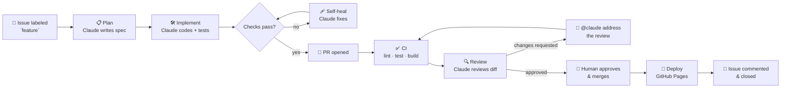

# TaskFlow: an SDLC run end to end by Claude and GitHub Actions

TaskFlow is a small task tracker. Its main purpose is to demo the pipeline around it: **you open a GitHub issue, and Claude plans, implements, tests and reviews the feature, then opens a PR. After you approve it, the feature deploys to production.**



## Workflows

| Workflow | Trigger | What happens |
|---|---|---|
| [`sdlc-pipeline.yml`](.github/workflows/sdlc-pipeline.yml) | Issue labeled `feature` (or run manually) | Plan → Implement → Self-heal → PR → CI → Review → Hand-off |
| [`ci.yml`](.github/workflows/ci.yml) | PR, or called by the pipeline | Type check, unit tests, production build |
| [`claude-review.yml`](.github/workflows/claude-review.yml) | PR, or called by the pipeline | Claude posts inline review comments and an approve or request-changes verdict, with labels |
| [`claude-mention.yml`](.github/workflows/claude-mention.yml) | `@claude` in a comment | Claude acts on the request, then CI and review run again |
| [`deploy.yml`](.github/workflows/deploy.yml) | Push to `main` | Build, deploy to GitHub Pages, comment the live URL and close the issue |

The guardrails Claude works within are written in [`CLAUDE.md`](CLAUDE.md).

## Demo script (about 5 minutes of live demo, about 10 minutes of pipeline time)

1. Show the live app at `https://<user>.github.io/claude-sdlc-demo/`.
2. Open **Issues → New issue → ✨ Feature request**, for example *"Add a dark mode toggle"*, and submit it. The `feature` label starts the pipeline. You can also add the `feature` label to one of the prepared issues.
3. Open **Actions → 🤖 SDLC Pipeline** and show the job graph running Plan → Implement → CI → Review.
4. Back on the issue, show Claude's **spec** comment, then the link to the **PR**.
5. On the PR, show the diff (code and tests), the green CI run, and **Claude's review** with its inline comments and verdict label.
6. Optional: comment `@claude please address the review` to show the fix loop.
7. **Approve and merge** the PR. This is the human-in-the-loop gate.
8. **Actions → 🚀 Deploy** runs. When it finishes, the issue gets a "Shipped to production" comment and closes.
9. Refresh the live app: the feature is there.

## Local development

```bash
npm install
npm run dev     # http://localhost:5173/claude-sdlc-demo/
npm test
```

## Security notes
- Only users with triage access or higher can add labels, so random visitors can't trigger Claude on this public repo.
- Claude's tools are allow-listed per job. It can edit files and run `npm test/lint/build`; git and PR operations are deterministic workflow steps.
- `ANTHROPIC_API_KEY` is stored as a repository secret.
